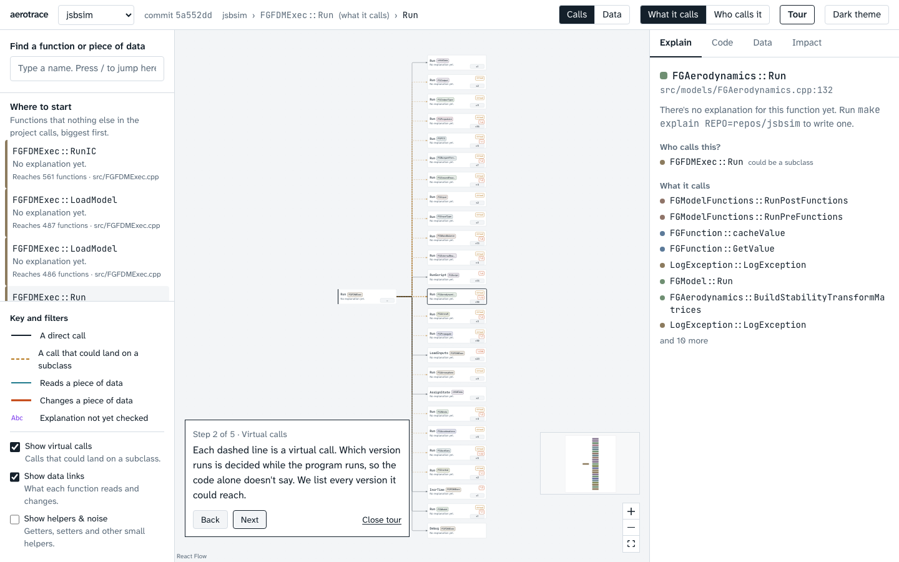

# aerotrace

Understand a large C/C++ codebase without reading all of it. aerotrace reads the code, works out who calls
whom and who changes which data, explains each function in plain English, and shows the result as a call tree
you can open step by step.



## Run it

You need Python 3.11+ with [uv](https://docs.astral.sh/uv/), Node 20+ with pnpm, and `git`.

```bash
make setup                  # installs the Python and web dependencies
make demo REPO=jsbsim       # clone, extract, enrich, load, explain, then start the app
# open http://localhost:5173/?repo=jsbsim   and press "Tour"
```

`make demo` prints the time and counts for every step and stops at the first one that fails.
Without an `ANTHROPIC_API_KEY` it skips the AI and writes template sentences only.

**With Docker** (needs `data/jsbsim.db`, which the `demo` branch includes, and `repos/jsbsim` for the Code tab):

```bash
docker compose up --build   # then open http://localhost:5173/?repo=jsbsim
```

### Offline demo

`AEROTRACE_OFFLINE=1` makes the app serve only explanations that are already saved and never call the API
(the compose file sets it for you). To get real explanations once, with a key and a network:

```bash
export ANTHROPIC_API_KEY=...
make explain REPO=jsbsim ARGS="--only-reachable-from-entry-points"   # prints a cost estimate and asks first
```

The explanations are saved in `data/jsbsim.db`, so the demo then works with no network.

## What you can do in it

- **Start**: the landing screen shows the repo in numbers and its top entry points. "Trace it" opens one.
- **Calls**: open any function's tree. Dashed amber lines are virtual calls (the possible targets are listed).
  "What it calls" and "Who calls it" flip the direction.
- **Explain / Code / Data / Impact** for the selected function: a plain-English explanation (flagged violet
  when it has not been checked), the source with marks for calls and data, what it reads and changes, and
  everything that could be affected if it changes.
- **Data lens**: pick a field and every function that changes it (red-orange) or reads it (teal) lights up.
- **Data map**: switch to "Data" to see a class's functions and the fields they touch. A dot marks data that
  more than one function changes.
- **Tour**: five steps through JSBSim, from its main step to the impact of one small helper.

## How it works

1. **Extract with libclang.** Every source file is parsed with the real C++ front end, in parallel and cached by
   file content. Functions, fields, calls, reads and writes become one language-neutral graph
   (`extractor/common/schema.py`). A call that cannot be pinned down is counted as unresolved, never guessed.
2. **Resolve virtual calls.** A call through a base-class pointer could land on any override. The enrich step
   builds the class hierarchy and adds a "may call" link to every override, so the dashed lines are real.
   It also tags helpers, finds entry points and measures reach.
3. **Explain bottom-up, then check.** Functions are explained callees first (cycles together), so each
   explanation can use the explanations of what it calls. Every answer is then checked against the graph:
   the names it mentions must exist and be connected, and the data it says it changes must really be written.
   Answers that fail are flagged, never hidden.
4. **Show it as a tree.** A FastAPI server reads the SQLite file; a React app lays the tree out with ELK in a
   web worker and opens it one level at a time.

## Tests

```bash
make test        # Python: extractor, enrich, explain, server, demo runner
make test-web    # the tree and layout logic (Vitest)
make e2e         # the app in a real browser (Playwright; run `make e2e-setup` once)
```

## Known limits

- Only C and C++ are supported so far (the graph format already has room for Ada).
- Without a compile database, flags are guessed from the folder layout, so a few files may not parse.
  JSBSim has 5 of 104 files with errors this way, and the extractor refuses to continue above 5%.
- Calls through plain function pointers and `std::function` are shown as "calls something through a pointer",
  with the target unknown.
- A trivial call such as `x.reset()` counts as a read of `x`; only assignments and `++`/`--` count as writes.
